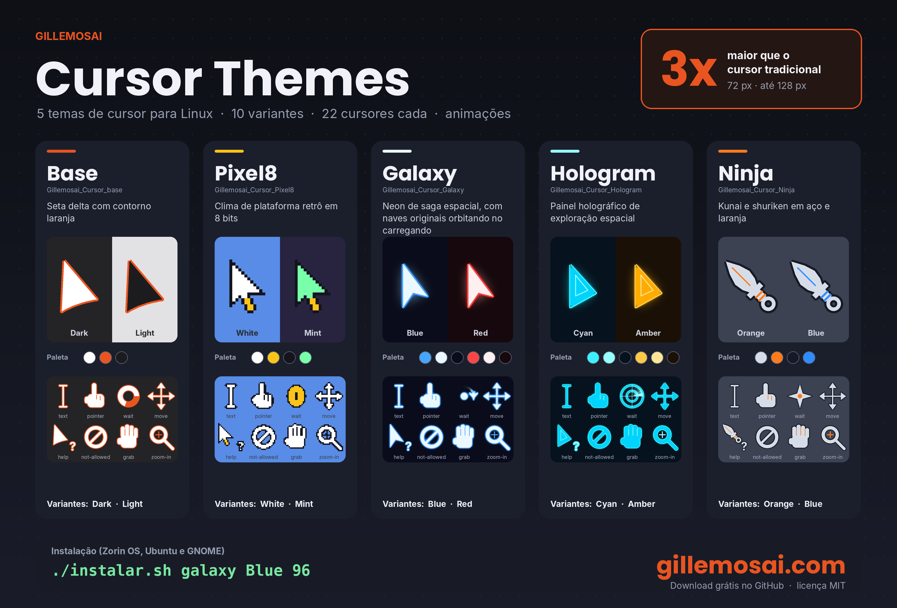
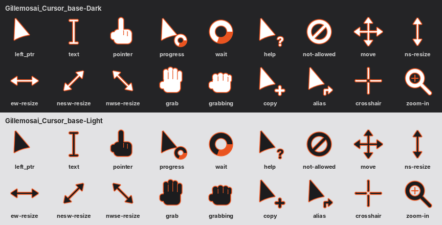
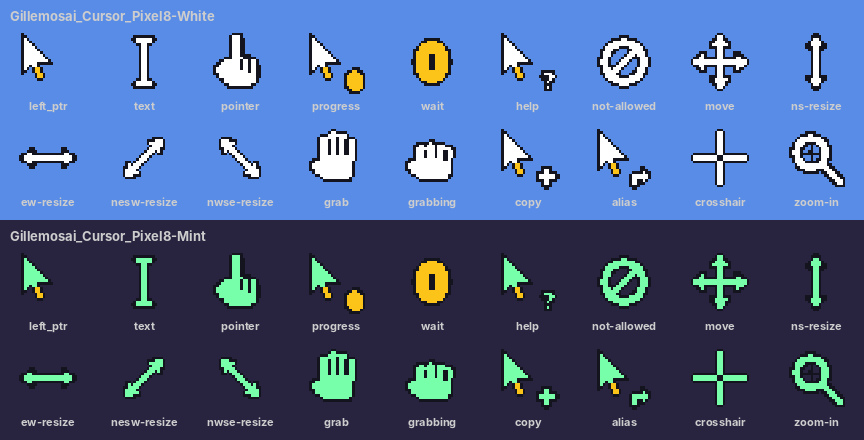
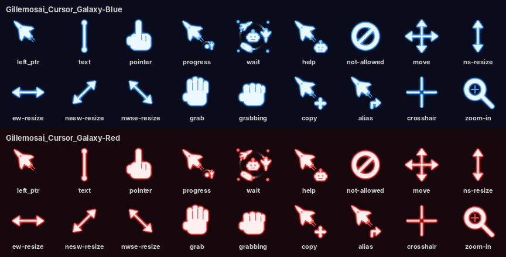
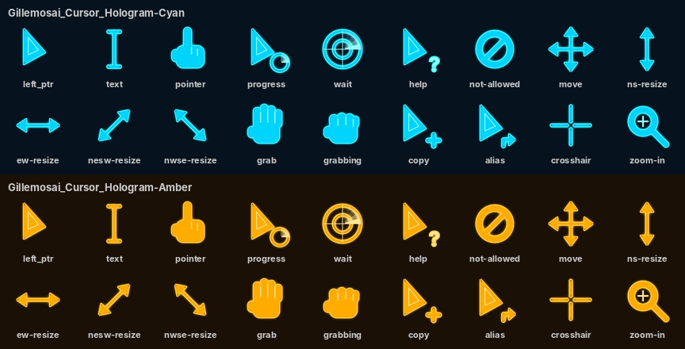
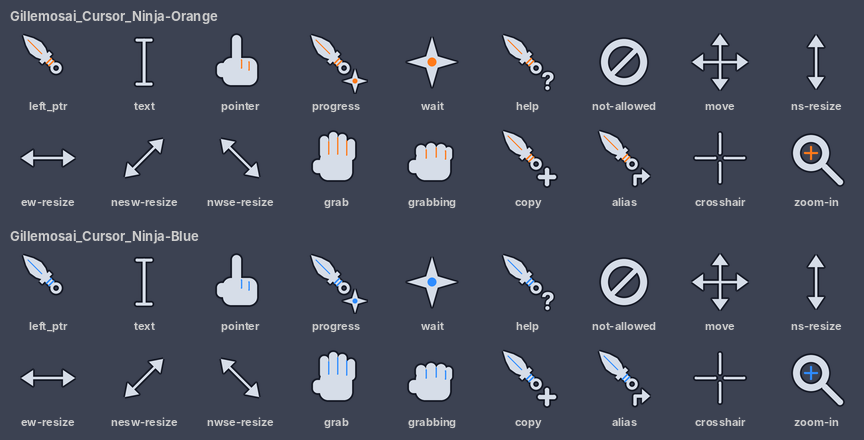

<div align="center">

# 🖱️ gillemosai-cursor-themes

**Cursores grandes e estilosos para Linux, feitos para quem grava tutoriais e faz lives: 5 temas originais, 10 variantes, animados e com 3x o tamanho tradicional.**

[](LICENSE)
[](#-instalação)
[](#-instalação)
[](#-instalação)
[](#-gerar-ou-personalizar)
[](#-gerar-ou-personalizar)
[](#-como-contribuir)
[](https://github.com/gillemosai/gillemosai-cursor-themes/stargazers)
[](https://github.com/gillemosai/gillemosai-cursor-themes/commits)

[Temas](#-os-temas) · [Instalação](#-instalação) · [O que vem em cada tema](#-o-que-vem-em-cada-tema) · [Personalizar](#-gerar-ou-personalizar) · [English](#-english)

© 2026 **Gil Lemos** · [gillemosai.com](https://gillemosai.com)



</div>

---

## 🤔 O problema

O cursor padrão do Linux tem 24 px. Em gravação de tela, live ou projetor, ele some, e quem assiste não acompanha onde você clicou. Este projeto entrega temas de cursor **a partir de 72 px (3x o tradicional)**, com contorno forte, visual marcante e animações de carregando, para o público enxergar cada clique.

## 🎨 Os temas

| Tema | Variantes | Estilo |
|---|---|---|
| **Gillemosai_Cursor_base** | Dark · Light | Seta delta com contorno laranja |
| **Gillemosai_Cursor_Pixel8** | White · Mint | Clima de plataforma retrô em 8 bits, com moeda girando no carregando |
| **Gillemosai_Cursor_Galaxy** | Blue · Red | Neon de ficção espacial: ponteiro em forma de caça estelar, feixes de energia, robozinho e frota de naves originais orbitando no carregando |
| **Gillemosai_Cursor_Hologram** | Cyan · Amber | Painel holográfico de exploração espacial, com radar no carregando |
| **Gillemosai_Cursor_Ninja** | Orange · Blue | Kunai e shuriken em aço, com shuriken girando no carregando |

### Prévias

**Base**


**Pixel8**


**Galaxy**


**Hologram**


**Ninja**


## 📥 Instalação

Para **Zorin OS, Ubuntu, GNOME e derivados**.

**1.** Baixe o projeto: botão verde **Code > Download ZIP** (ou use `git clone`) e extraia.

**2.** Abra o terminal dentro da pasta extraída.

**3.** Rode o instalador com o tema, a variante e, se quiser, o tamanho:

```bash
./instalar.sh <tema> <variante> [tamanho]
```

| Comando | O que faz |
|---|---|
| `./instalar.sh base Dark 72` | Seta delta, 3x o tamanho tradicional |
| `./instalar.sh galaxy Blue 96` | Neon azul, 4x |
| `./instalar.sh pixel8 White 72` | 8 bits |
| `./instalar.sh hologram Cyan 72` | Holograma ciano |
| `./instalar.sh ninja Orange 96` | Kunai laranja, 4x |
| `./instalar.sh` | Mostra a lista completa de temas e variantes |

> Se algum aplicativo ainda mostrar o cursor antigo, **saia da sessão e entre de novo**.
>
> Se o script não executar, dê permissão: `chmod +x instalar.sh desinstalar.sh`

### Mudar só o tamanho

```bash
gsettings set org.gnome.desktop.interface cursor-size 96
```

Tamanhos incluídos: **24, 48, 72, 96 e 128** (no Pixel8: 24, 48, 72, 96 e 120, para manter os pixels perfeitos).

### Outros ambientes (KDE, XFCE, Cinnamon…)

O instalador copia os temas para `~/.local/share/icons` e `~/.icons`. Depois é só escolher o tema `Gillemosai_Cursor_...` nas configurações de cursor do seu ambiente.

### Desinstalar

```bash
./desinstalar.sh
```

Remove os temas Gillemosai e volta ao cursor padrão do sistema.

## 🧩 O que vem em cada tema

Seta, texto, texto vertical, mãozinha de clique, mão de arrastar (aberta e fechada), cruz, célula, mover, redimensionar nas 4 direções, proibido, ajuda, copiar, atalho, menu de contexto, zoom (mais e menos), **carregando e espera animados**, além de mais de 80 atalhos de nomes antigos e hashes, para o cursor funcionar em GTK, Qt, navegadores e apps legados.

## 🛠️ Gerar ou personalizar

Os cursores são desenhados em código (vetorial) e gerados em formato Xcursor:

```bash
pip install pillow
python3 src/make_themes.py
```

Os temas ficam em `build/` e os pacotes em `dist/`. Para criar o seu, edite as cores e os desenhos em `src/make_themes.py`. O painel-resumo `docs/resumo-behance.png` é gerado por `src/make_behance.py`.

## 🤝 Como contribuir

Ideias de novos temas, variantes de cor, versões para Windows (`.cur`/`.ani`) e relatos de problemas em outras distribuições são muito bem-vindos. Abra uma [issue](https://github.com/gillemosai/gillemosai-cursor-themes/issues) ou envie um pull request.

## 🌎 English

**Large, stylish cursor themes for Linux, made for tutorial creators and streamers.** 5 original themes, 10 variants, 22 cursors each, animated, with a default size of **72 px (3x the usual 24 px)** and options up to 128 px.

Download the repo, open a terminal in the folder and run:

```bash
./instalar.sh galaxy Blue 96    # ./instalar.sh <theme> <variant> [size]
```

Run `./instalar.sh` without arguments to list every theme and variant. To uninstall, run `./desinstalar.sh`. Built for GNOME-based desktops (Zorin OS, Ubuntu); the themes are standard Xcursor, so they also work on KDE, XFCE and Cinnamon. Reports and PRs are welcome.

## ⚠️ Aviso

Os desenhos são **originais**, inspirados na estética de gêneros nerds (plataforma retrô, ficção espacial, ninja). Não usam personagens, logos ou marcas de nenhuma franquia, e o projeto não é afiliado a nenhuma delas. O instalador só copia arquivos de tema e altera as configurações de cursor, e pode ser desfeito com `desinstalar.sh`.

## 📄 Licença

[MIT](LICENSE). Use, modifique e compartilhe, mantendo o crédito a **[Gil Lemos](https://gillemosai.com)**.

---

<div align="center">

### Feito por Gil Lemos

Eu traduzo tecnologia e inteligência artificial em soluções práticas: automações, apps e ferramentas para quem quer usar tecnologia sem complicação.

**Conheça meus outros projetos ou fale comigo sobre o seu:**

[](https://gillemosai.com)

Se este projeto te ajudou, deixe uma ⭐. Isso ajuda outras pessoas que gravam tutoriais a encontrá-lo.

</div>
